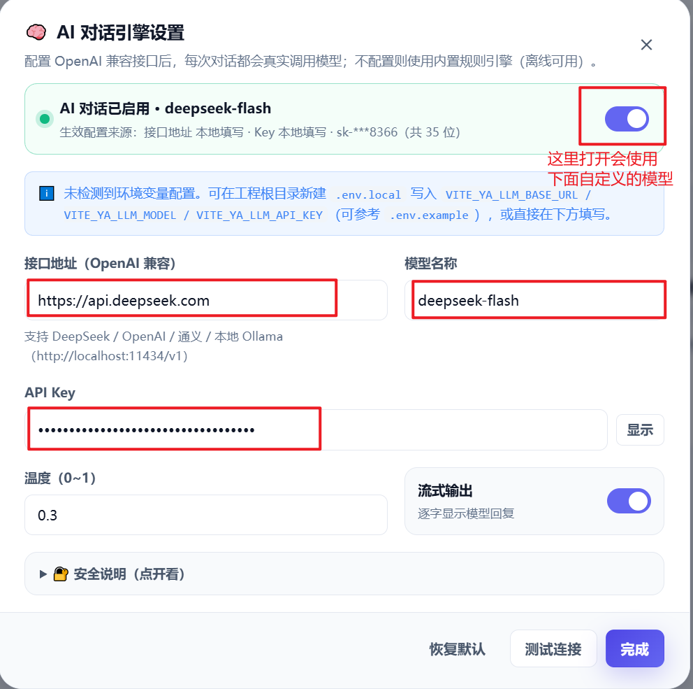

本项目有两种大模型配置方式

1 - 项目内配置文件配置
通过修改[.env.example](.env.example)文件内的VITE_YA_LLM_BASE_URL, VITE_YA_LLM_MODEL, VITE_YA_LLM_API_KEY 进行配置
```bash
VITE_YA_LLM_BASE_URL=

# 模型名称，例如 deepseek-chat / gpt-4o-mini / qwen-plus / llama3.1
VITE_YA_LLM_MODEL=

# API Key
VITE_YA_LLM_API_KEY=
```

2 - 项目启动后在首页右上角进行配置



如果需要API key可以钉钉/Mail联系本人 付康博 (kangbofu)

如果未进行任何配置，系统会通过固定的JS响应用户输入，不具有智能回复功能。
